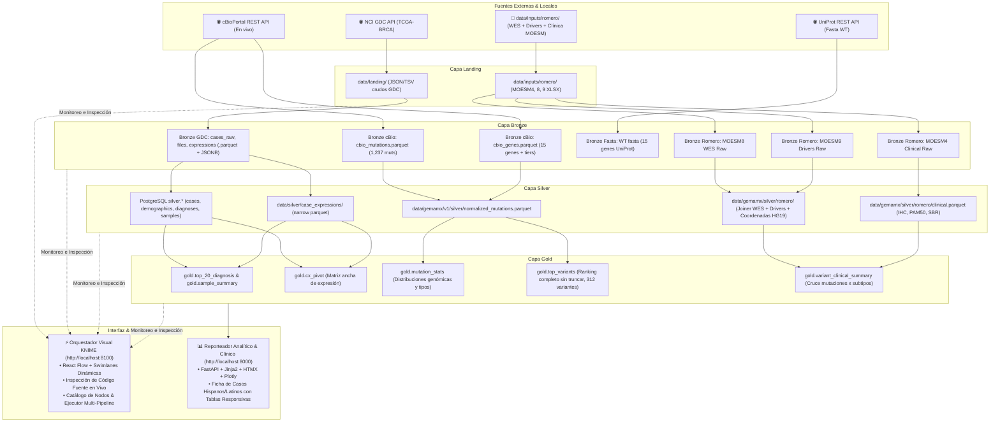

# TCGA Medallion

Pipeline de datos del [The Cancer Genome Atlas (TCGA)](https://www.cancer.gov/tcga) con arquitectura medallón (landing → bronze → silver → gold) y una página web de consulta y reportes, todo en contenedores Docker. El enfoque predeterminado es el cáncer de mama (**proyecto `TCGA-BRCA`**), aunque la variable `GDC_PROJECTS` permite añadir cualquier otro proyecto TCGA sin cambiar código.

Los datos se obtienen exclusivamente de la API pública del [NCI Genomic Data Commons (GDC)](https://gdc.cancer.gov/). Solo se usan datos de **acceso abierto**; no se requieren credenciales de dbGaP ni se descargan datos controlados.

---

## Inicio rápido

### Requisitos previos

- Docker Engine ≥ 24 con Docker Compose v2
- ~50 GB de espacio libre en disco para el conjunto completo de TCGA-BRCA (~1,300 archivos de expresión)
- Conexión a internet para descargar de la API del GDC

### 1. Clonar y configurar

```bash
git clone <url-del-repositorio> tcga-medallion
cd tcga-medallion
cp .env.example .env
# Edita .env y cambia las contraseñas antes de continuar
```

### 2. Levantar los servicios base

```bash
make up
# Espera hasta que los healthchecks de postgres y web estén en estado "healthy"
# Web accesible en http://localhost:8000
```

### 3. Inicializar la base de datos

```bash
make init-db
```

### 4. Pipeline completo para TCGA-BRCA

```bash
make run-brca          # puede tardar varias horas en la primera ejecución
```

### 5. Prueba rápida (5 archivos de expresión)

```bash
make smoke
```

### 6. Pruebas unitarias

```bash
make test              # sin acceso a internet
```

### Mapa del código con Graphify

Graphify crea un grafo local del código para consultar arquitectura y relaciones entre módulos desde el asistente. Los datos descargados y las exportaciones quedan fuera del grafo.

```bash
uv tool install 'graphifyy[sql]'
uv tool run --from 'graphifyy[sql]' graphify install --project --platform copilot
uv tool run --from 'graphifyy[sql]' graphify . --code-only
uv tool run --from 'graphifyy[sql]' graphify cluster-only .
```

Desde `graphify-out/` se pueden consultar los archivos generados con `uv tool run --from 'graphifyy[sql]' graphify query`, `explain` y `path`. El grafo es local y no se versiona.

---

## Servicios Docker

| Servicio       | Imagen base              | Función                                       | Puerto host  |
|----------------|--------------------------|-----------------------------------------------|--------------|
| `postgres`     | `postgres:16.9-bookworm` | Metadatos, silver clínico, gold y registro    | interno      |
| `etl`          | Python 3.12 slim         | CLI `tcga` — ejecuta todos los ETL            | ninguno      |
| `web`          | Python 3.12 slim         | Página de consulta y reportes (FastAPI)       | 8000         |
| `scheduler`    | misma que `etl`          | Revisa semanalmente nuevas versiones del GDC  | ninguno      |
| `adminer`      | `adminer:4.8.1`          | Inspección de la base de datos                | 8080         |

`scheduler` y `adminer` son opcionales y se activan con perfiles:

```bash
docker compose --profile scheduler --profile tools up -d
```

---

## Comandos CLI

Todos los comandos corren dentro del contenedor `etl`:

```bash
# Pipeline completo
docker compose run --rm etl tcga run --project TCGA-BRCA

# Capas individuales
docker compose run --rm etl tcga run --project TCGA-BRCA --layers landing,bronze
docker compose run --rm etl tcga run --project TCGA-BRCA --layers silver,gold

# ETLs individuales
docker compose run --rm etl tcga extract-cases        --project TCGA-BRCA
docker compose run --rm etl tcga extract-files-manifest --project TCGA-BRCA
docker compose run --rm etl tcga download-expressions --project TCGA-BRCA --limit 20
docker compose run --rm etl tcga bronze-cases         --project TCGA-BRCA
docker compose run --rm etl tcga bronze-files         --project TCGA-BRCA
docker compose run --rm etl tcga bronze-expressions   --project TCGA-BRCA
docker compose run --rm etl tcga silver-clinical      --project TCGA-BRCA
docker compose run --rm etl tcga silver-case-expressions --project TCGA-BRCA
docker compose run --rm etl tcga gold-top-diagnosis   --project TCGA-BRCA
docker compose run --rm etl tcga gold-cx-pivot        --project TCGA-BRCA --top-genes 100
docker compose run --rm etl tcga gold-extras          --project TCGA-BRCA

# Estado del pipeline
docker compose run --rm etl tcga status
```

Opciones útiles de `gold-cx-pivot`:

| Opción          | Predeterminado       | Descripción                                      |
|-----------------|----------------------|--------------------------------------------------|
| `--top-genes N` | 100                  | Número de genes con mayor varianza a incluir     |
| `--metric`      | `fpkm_unstranded`    | Métrica de expresión (`tpm_unstranded` también)  |
| `--log2`        | desactivado          | Aplica log₂(x + 1) antes de calcular la varianza |
| `--sample-type` | todos                | Filtra por tipo de muestra (p. ej. `Primary Tumor`) |

---

## Reporte ampliado por caso

Genera un JSON clínico y molecular para un caso por `submitter_id` o UUID. Si el identificador resuelve a más de un caso, el selector prioriza `HISPANIC OR LATINO` y después `TCGA-BRCA`. La salida se guarda en `/data/case_reports/<submitter_id>/report.json`, que el PDF por caso incorpora automáticamente si está en el volumen compartido.

```bash
docker compose run --rm --no-deps etl tcga case-report TCGA-5L-AAT1
```

Para generar reportes de todos los casos `HISPANIC OR LATINO` del proyecto (incluye percentiles completos y continúa aunque falle un caso):

```bash
docker compose run --rm --no-deps etl tcga case-report-batch --project TCGA-BRCA
```

El lote guarda un `report.json` por `submitter_id` en `data/case_reports/` y se puede reanudar: los reportes válidos y paneles de expresión ya cacheados se reutilizan. `--no-percentiles` omite el cálculo de cohortes; `--limit 10` procesa como máximo diez casos para una prueba.

Para mantener una URL anterior cuando el GDC haya reemplazado el UUID pero el `submitter_id` sea el mismo, registra el UUID antiguo como alias verificado:

```bash
docker compose run --rm --no-deps etl tcga case-report TCGA-5L-AAT1 \
  --legacy-case-id 16fc3677-0393-4ed1-adf3-c8355f056369 --refresh
```

La web solo resuelve ese alias si coincide con el reporte cacheado y con el mismo `submitter_id` en Silver.

El inventario lista archivos abiertos y controlados, pero solo descarga archivos `access=open`. El reporte reúne clínica expandida, seguimiento, TNM, receptores clínicos disponibles, mutaciones driver, CNV, expresión, anotaciones, cronología y capas faltantes. Los suplementos curados son opcionales:

```bash
docker compose run --rm --no-deps etl tcga case-report TCGA-5L-AAT1 \
  --cdr /data/TCGA-CDR-SupplementalTableS1.xlsx --pam50 /data/pam50.tsv --panc /data/pancanatlas.tsv
```

Los percentiles por cohorte no se descargan por defecto; activarlos puede recorrer muchos archivos. Incluyen TCGA-BRCA, lobulillares (`8520/3`), hispanos/latinos y lobulillares hispanos/latinos; la caché conserva solo el panel de genes por archivo:

```bash
docker compose run --rm --no-deps etl tcga case-report TCGA-5L-AAT1 \
  --percentiles --max-cohort-files 100 --workers 2
```

También está disponible `python gdc_case_report.py TCGA-5L-AAT1 --out out` para generar `out/TCGA-5L-AAT1/report.json`.

---

## Arquitectura del proyecto

El sistema implementa una **Arquitectura Medallón Multi-Cohorte** (Landing → Bronze → Silver → Gold) orquestada a través del ejecutor interactivo reactivo (`flow`) y consumida tanto por la aplicación web analítica (`web`) como por herramientas de bioinformática y visualización.



### Capa landing

| Directorio                              | Contenido                              |
|-----------------------------------------|----------------------------------------|
| `data/landing/cases/<proyecto>/`        | `page_<n>.json` — páginas de casos     |
| `data/landing/files/<proyecto>/`        | `manifest.json` — manifiesto de archivos |
| `data/landing/expressions/<proyecto>/<file_id>/` | TSV de expresión génica uno por muestra |

### Capa bronze

| Directorio / tabla                          | Contenido                                  |
|---------------------------------------------|--------------------------------------------|
| `data/bronze/cases/<proyecto>/`             | Parquet aplanado: casos, diagnósticos, exposiciones, muestras |
| `data/bronze/files/<proyecto>/`             | Parquet del manifiesto                     |
| `data/bronze/expressions/project_id=<P>/`  | Parquet de expresión particionado          |
| `bronze.cases_raw` (PostgreSQL)             | JSON original de cada caso como JSONB      |

### Capa silver (PostgreSQL)

| Tabla                        | Contenido                                               | Clave         |
|------------------------------|---------------------------------------------------------|---------------|
| `silver.cases`               | Un registro por caso: sitio primario, tipo de enfermedad | `case_id`    |
| `silver.cases_demographics`  | Sexo, raza, etnicidad, estado vital, días a la muerte   | `case_id`    |
| `silver.cases_diagnoses`     | Diagnóstico, estadio AJCC, edad al diagnóstico          | `diagnosis_id` |
| `silver.cases_exposures`     | Historial de alcohol y tabaco                           | `exposure_id` |
| `silver.samples`             | Tipo de muestra (tumor primario, normal, etc.)          | `sample_id`  |
| `silver.files`               | Archivos de expresión con case_id y sample_id           | `file_id`    |

`data/silver/case_expressions/project_id=<P>/` — Parquet narrow: una fila por gen y por archivo, con `case_id`, `sample_id`, `sample_type`, `file_id`, `gene_id`, `gene_name`, `gene_type`, `unstranded`, `tpm_unstranded`, `fpkm_unstranded`, `fpkm_uq_unstranded`.

### Capa gold (PostgreSQL + Parquet)

| Tabla / directorio              | Contenido                                                    |
|---------------------------------|--------------------------------------------------------------|
| `gold.top_20_diagnosis`         | Los 20 diagnósticos primarios más frecuentes con porcentaje  |
| `gold.cx_pivot`                 | Matriz ancha: una fila por muestra, una columna por gen (N genes de mayor varianza) |
| `gold.gene_dim`                 | Dimensión de genes: `gene_id`, `gene_name`, `gene_type`      |
| `gold.sample_summary`           | Casos y muestras por tipo de muestra, estado vital y estadio |
| `gold.gene_stats`               | Media, varianza y muestras >0 por gen y por tipo de muestra  |
| `data/gold/cx_pivot/`           | Parquet de la matriz ancha                                   |

### Operaciones (PostgreSQL, esquema `ops`)

| Tabla                    | Contenido                                                  |
|--------------------------|------------------------------------------------------------|
| `ops.pipeline_runs`      | Registro de cada paso ETL: estado, filas, timestamps, error |
| `ops.download_control`   | Cola de descarga idempotente: estado, md5, intentos        |
| `ops.dq_results`         | Verificaciones de calidad: `critical` (detiene) / `warning` |
| `ops.gdc_status`         | Última versión de datos del GDC comprobada                 |

---

## ETLs: descripción y campos de la API

### E01 `extract-cases`

Consulta `GET /cases` paginando de 1,000 registros con `from` y `size` hasta agotar el total. Guarda cada página como JSON en `landing/cases/<proyecto>/page_<n>.json`.

**Campos solicitados a `/cases` (verificados contra `/cases/_mapping`):**

```
case_id, submitter_id, primary_site, disease_type, consent_type,
project.project_id, project.name,
demographic.demographic_id, demographic.sex_at_birth, demographic.race,
  demographic.ethnicity, demographic.vital_status, demographic.days_to_death,
  demographic.days_to_birth, demographic.age_at_index, demographic.year_of_birth,
  demographic.year_of_death, demographic.cause_of_death, demographic.marital_status,
  demographic.education_level, demographic.country_of_residence_at_enrollment,
  demographic.state, demographic.updated_datetime,
diagnoses.diagnosis_id, diagnoses.submitter_id, diagnoses.primary_diagnosis,
  diagnoses.tissue_or_organ_of_origin, diagnoses.classification_of_tumor,
  diagnoses.tumor_grade, diagnoses.ajcc_pathologic_stage, diagnoses.ajcc_pathologic_t,
  diagnoses.ajcc_pathologic_n, diagnoses.ajcc_pathologic_m, diagnoses.ajcc_clinical_stage,
  diagnoses.age_at_diagnosis, diagnoses.days_to_diagnosis, diagnoses.days_to_last_follow_up,
  diagnoses.last_known_disease_status, diagnoses.morphology, diagnoses.laterality,
  diagnoses.site_of_resection_or_biopsy, diagnoses.year_of_diagnosis,
  diagnoses.days_to_recurrence, diagnoses.progression_or_recurrence,
  diagnoses.diagnosis_is_primary_disease,
  diagnoses.treatments.treatment_id, diagnoses.treatments.therapeutic_agents,
  diagnoses.treatments.treatment_type, diagnoses.treatments.treatment_or_therapy,
  diagnoses.treatments.days_to_treatment_start, diagnoses.treatments.days_to_treatment_end,
  diagnoses.treatments.regimen_or_line_of_therapy,
exposures.exposure_id, exposures.submitter_id, exposures.alcohol_history,
  exposures.alcohol_intensity, exposures.alcohol_drinks_per_day,
  exposures.cigarettes_per_day, exposures.pack_years_smoked,
  exposures.smoking_frequency, exposures.tobacco_smoking_status,
  exposures.tobacco_smoking_onset_year, exposures.tobacco_smoking_quit_year,
  exposures.type_of_tobacco_used, exposures.exposure_duration_years,
  exposures.asbestos_exposure_type, exposures.environmental_tobacco_smoke_exposure,
  exposures.secondhand_smoke_as_child,
samples.sample_id, samples.submitter_id, samples.sample_type, samples.tissue_type,
  samples.tumor_descriptor, samples.specimen_type, samples.biospecimen_anatomic_site,
  samples.preservation_method, samples.days_to_collection
```

### E02 `extract-files-manifest`

Consulta `POST /files` filtrando por:
- `cases.project.project_id = <proyecto>`
- `data_category = Transcriptome Profiling`
- `data_type = Gene Expression Quantification`
- `analysis.workflow_type = STAR - Counts`
- `access = open`

**Campos solicitados a `/files` (verificados contra `/files/_mapping`):**

```
file_id, file_name, file_size, md5sum, access, data_category, data_type, data_format,
experimental_strategy, analysis.workflow_type,
cases.case_id, cases.project.project_id,
cases.samples.sample_id, cases.samples.submitter_id, cases.samples.sample_type
```

### E03 `download-expressions`

- Gestiona una cola idempotente en `ops.download_control` (estado: `pending`, `complete`, `failed`).
- Agrupa archivos en lotes de ~1 GB por tamaño declarado y los descarga con `POST /data` (`{"ids": [...]}`).
- Máximo 2 descargas concurrentes; reintentos con espera exponencial (configurable con `GDC_HTTP_RETRIES` y `GDC_HTTP_BACKOFF`).
- Valida el `md5sum` de cada archivo contra el manifiesto.
- Si se interrumpe, relanzar retoma desde donde quedó.
- Opción `--limit N` para pruebas con pocos archivos.

### E04 `bronze-cases` y `bronze-files`

Aplana el JSON anidado a Parquet en `bronze/cases/` (casos, diagnósticos, exposiciones, muestras) y `bronze/files/`. Almacena además el JSON original en `bronze.cases_raw` (columna `JSONB`). Todas las tablas bronze incluyen `_ingested_at`, `_source_file` y `_gdc_data_release`.

### E05 `bronze-expressions`

Lee todos los TSV de `landing/expressions/` con DuckDB. El parser:
- Ignora la línea de comentario inicial (`# gene-model: ...`).
- Descarta filas cuyo `gene_id` empieza con `N_` (`N_unmapped`, `N_multimapping`, `N_noFeature`, `N_ambiguous`).
- Conserva las nueve columnas originales sin transformar.
- Escribe Parquet particionado por `project_id` en `bronze/expressions/`.
- Verifica que el número de genes por archivo sea aproximadamente 60,660 (advertencia si difiere).

### S01 `silver-case-expressions`

Une `bronze/expressions` con `bronze/files` por `file_id` para asociar `case_id`, `sample_id` y `sample_type` a cada fila de expresión. Resultado narrow: una fila por gen y por archivo. Escribe Parquet particionado en `silver/case_expressions/`. Impone clave única `(file_id, gene_id)`.

### S02 `silver-clinical`

Normaliza los Parquet bronze a las tablas PostgreSQL del esquema `silver`: tipos correctos, valores faltantes como `NULL` (nunca texto vacío ni `"Not Reported"` convertido), integridad referencial verificada tras la carga.

### G01 `gold-top-diagnosis`

Cuenta casos por `primary_diagnosis` en `silver.cases_diagnoses`, ordena de mayor a menor y guarda los 20 primeros en `gold.top_20_diagnosis` con `diagnosis`, `cases`, `pct` y `diagnosis_rank`.

### G02 `gold-cx-pivot`

1. Calcula la varianza de la métrica elegida por gen con DuckDB sobre `silver/case_expressions`.
2. Selecciona los N genes con mayor varianza.
3. Genera la matriz ancha con `MAX(val) FILTER (WHERE gene_id = X)` por gen.
4. Escribe en `gold/cx_pivot/` (Parquet) y recrea la tabla `gold.cx_pivot` en PostgreSQL con columnas dinámicas tipadas como `DOUBLE PRECISION`.
5. Rellena `gold.gene_dim` para traducir columnas a nombres de gen.

Los identificadores de columna se validan con una expresión regular para evitar inyecciones de SQL en el DDL dinámico.

### `gold-extras`

- `gold.sample_summary` — casos y muestras por `sample_type`, `vital_status` y `ajcc_pathologic_stage`.
- `gold.gene_stats` — media, varianza y recuento de muestras >0 por gen y por `sample_type` sobre `silver/case_expressions`.

---

## Página web

Accesible en `http://localhost:8000` (español). Solo lectura; conecta con el rol `web_ro`.

| Página      | URL          | Contenido                                                                      |
|-------------|--------------|--------------------------------------------------------------------------------|
| Estado      | `/`          | Estado de cada paso ETL, versión de datos del GDC, avance de descargas, alertas de calidad |
| Casos       | `/casos`     | Tabla filtrable (sexo, raza, estado vital, diagnóstico, estadio) con paginación y exportación CSV; ficha detallada por caso |
| Expresión   | `/genes`     | Búsqueda de gen por nombre (autocompletado), box plots por tipo de muestra y estadio, estadísticas descargables |
| Reportes    | `/reportes`  | R1 diagnósticos, R2 demografía, R3 muestras, R4 mapa de calor + PCA; exportación CSV por reporte |
| Salud       | `/health`    | Endpoint JSON para el healthcheck del contenedor                               |

---

## Variables de entorno

Copia `.env.example` a `.env` y ajusta los valores. Las contraseñas nunca se versionan.

| Variable                    | Predeterminado              | Descripción                                            |
|-----------------------------|-----------------------------|--------------------------------------------------------|
| `POSTGRES_DB`               | `tcga`                      | Nombre de la base de datos                             |
| `POSTGRES_USER`             | `tcga_admin`                | Superusuario de PostgreSQL                             |
| `POSTGRES_PASSWORD`         | —                           | Contraseña del superusuario (obligatoria)              |
| `ETL_DB_USER`               | `etl_rw`                    | Rol de escritura para el ETL                           |
| `ETL_DB_PASSWORD`           | —                           | Contraseña del rol ETL (obligatoria)                   |
| `WEB_DB_USER`               | `web_ro`                    | Rol de solo lectura para la web                        |
| `WEB_DB_PASSWORD`           | —                           | Contraseña del rol web (obligatoria)                   |
| `GDC_PROJECTS`              | `TCGA-BRCA`                 | Lista separada por comas de proyectos TCGA             |
| `GDC_API_URL`               | `https://api.gdc.cancer.gov`| URL base de la API del GDC                             |
| `GDC_DOWNLOAD_WORKERS`      | `2`                         | Descargas concurrentes (máximo 2 para respetar el servicio público) |
| `GDC_DOWNLOAD_BATCH_BYTES`  | `1000000000`                | Tamaño máximo de cada lote de descarga (~1 GB)         |
| `GDC_HTTP_TIMEOUT`          | `120`                       | Tiempo de espera HTTP en segundos                      |
| `GDC_HTTP_RETRIES`          | `5`                         | Número máximo de reintentos por petición               |
| `GDC_HTTP_BACKOFF`          | `2`                         | Factor de la espera exponencial entre reintentos       |
| `DUCKDB_MEMORY_LIMIT`       | `2GB`                       | Límite de memoria para DuckDB (ETL)                    |
| `DUCKDB_MEMORY_LIMIT_WEB`   | `1GB`                       | Límite de memoria para DuckDB (web)                    |
| `DUCKDB_THREADS`            | `2`                         | Hilos para DuckDB                                      |
| `WEB_PORT`                  | `8000`                      | Puerto del host para la página web                     |
| `ADMINER_PORT`              | `8080`                      | Puerto del host para Adminer                           |
| `LOG_LEVEL`                 | `INFO`                      | Nivel de registro (`DEBUG`, `INFO`, `WARNING`)         |
| `SCHEDULER_INTERVAL_SECONDS`| `604800`                    | Intervalo del scheduler en segundos (default: 1 semana)|

---

## Calidad de datos

Tras cada capa, las verificaciones se registran en `ops.dq_results`:

- **Críticas** (detienen el pipeline si fallan): md5 válido de archivos descargados, clave única `(file_id, gene_id)` en S01, `case_id` único en `silver.cases`, `case_id` no nulo en tablas silver, integridad referencial entre tablas clínicas.
- **Advertencias** (solo avisan): número de genes por archivo distinto de ~60,660, casos sin archivo de expresión, archivos del manifiesto sin caso asociado, diferencia entre total de casos del GDC y total cargado.

Los fallos y advertencias son visibles en la página de Estado de la web.

---

## Pruebas

```bash
make test       # unitarias + integración (sin internet, en contenedor)
make smoke      # smoke contra el GDC real con 5 archivos de expresión
```

| Archivo                       | Tipo         | Qué prueba                                                 |
|-------------------------------|--------------|------------------------------------------------------------|
| `tests/test_expression.py`    | Unitario     | Parser TSV: comentarios, filas `N_*`, 9 columnas, cabecera faltante |
| `tests/test_gdc_client.py`    | Unitario     | Paginación, retry 503, error 400, descarga, extracción tar, path traversal |
| `tests/test_landing_batches.py` | Unitario   | `chunk_by_size`: agrupación, archivo mayor que lote, lista vacía |
| `tests/test_integration.py`   | Integración  | Pipeline completo sobre datos mínimos; verifica tablas bronze/silver/gold |
| `tests/test_smoke.py`         | Smoke        | `/status` del GDC accesible; pipeline con `--limit 5` pasa sin errores |
| `tests/test_web.py`           | Web          | `/health`, páginas principales sin BD, 404 de caso inexistente |

---

## Estructura del repositorio

```
tcga-medallion/
├── docker-compose.yml         # postgres, etl, web, scheduler (profile), adminer (profile)
├── .env.example               # plantilla de configuración sin secretos
├── Makefile                   # up, down, build, init-db, run-brca, smoke, test, lint, status, reset
├── README.md                  # este archivo
├── etl/
│   ├── Dockerfile             # multi-stage, Python 3.12 slim, usuario no-root
│   ├── pyproject.toml         # dependencias fijadas, punto de entrada tcga
│   ├── uv.lock                # versiones exactas bloqueadas
│   └── src/tcga/
│       ├── cli.py             # comandos Typer (uno por ETL + run orquestador)
│       ├── config.py          # variables de entorno con Settings.from_env()
│       ├── common.py          # utilidades: write_json, md5sum, clean_text, safe_int
│       ├── db.py              # conexión PostgreSQL (psycopg3), init_schema()
│       ├── duck.py            # DuckDB helpers: duck_connect(), write_parquet()
│       ├── expression.py      # parser TSV: iter_expression_rows()
│       ├── logging_utils.py   # JSON logging con run_id, paso y proyecto
│       ├── gdc/
│       │   ├── client.py      # GDCClient: paginación, reintentos, batches, extracción
│       │   └── fields.py      # CASE_FIELDS, FILE_FIELDS, filtros, EXPECTED_GENES_PER_FILE
│       ├── landing/
│       │   ├── cases.py       # E01 extract_cases
│       │   ├── files.py       # E02 extract_files_manifest
│       │   └── expressions.py # E03 download_expressions
│       ├── bronze/
│       │   ├── cases.py       # E04 bronze_cases + bronze_files
│       │   └── expressions.py # E05 bronze_expressions
│       ├── silver/
│       │   ├── clinical.py    # S02 tablas clínicas PostgreSQL
│       │   └── case_expressions.py # S01 expresión narrow Parquet
│       ├── gold/
│       │   ├── top_diagnosis.py # G01 gold_top_20_diagnosis
│       │   ├── cx_pivot.py    # G02 gold_cx_pivot + gene_dim
│       │   └── extras.py      # sample_summary + gene_stats
│       └── ops/
│           └── runs.py        # pipeline_step(), record_dq(), gdc_status
├── web/
│   ├── Dockerfile             # multi-stage, Python 3.12 slim, usuario no-root
│   ├── pyproject.toml
│   └── app/
│       ├── main.py            # FastAPI: /, /casos, /genes, /reportes, /health
│       ├── db.py              # consultas PostgreSQL de solo lectura (web_ro)
│       ├── analytics.py       # DuckDB de solo lectura sobre Parquet
│       ├── config.py          # WebSettings.from_env()
│       ├── templates/         # Jinja2: base, status, cases, gene, reports…
│       └── static/            # CSS y Plotly.js (vendor local)
├── sql/
│   ├── 00_roles.sh            # crea roles etl_rw y web_ro (idempotente)
│   └── 001_schema.sql         # DDL: bronze, silver, gold, ops con índices y grants
├── tests/
│   ├── fixtures/
│   │   └── expression_sample.tsv  # TSV de ejemplo para pruebas del parser
│   ├── test_expression.py
│   ├── test_gdc_client.py
│   ├── test_landing_batches.py
│   ├── test_integration.py
│   ├── test_smoke.py
│   └── test_web.py
└── data/                      # no se versiona (.gitignore)
    ├── landing/
    ├── bronze/
    ├── silver/
    └── gold/
```

---

## Ejecutor visual tipo KNIME (servicio `flow`)

El servicio `flow` añade un lienzo interactivo y reactivo para orquestar visualmente los pipelines medallón de:
1. **TCGA v3**: GDC TCGA-BRCA completo (landing → bronze → silver → gold; 18 nodos, 20 aristas).
2. **GEMAMX v1**: TCGA-BRCA vía API cBioPortal con normalización y variantes prioritarias (DNA-only).
3. **GEMAMX v2**: Cohorte mexicana Romero-Córdoba 2021 (*Nat. Commun.* 2021, DOI 10.1038/s41467-021-22478-y) desde suplementarios MOESM8 (MAF) y MOESM9 (drivers), filtrado de genes clave y cálculo de top variantes.
4. **GEMAMX v2.1**: Extensión clínica y genómica que incorpora enriquecimiento de datos clínicos MOESM4 (IHC · PAM50 · SBR) y cruce con variantes somáticas (M1-M2 + M5).

### Características y UI
- **Página Unificada con Pestañas Independientes**:
  - `⚡ Flujos (8100)`: Lienzo interactivo del orquestador tipo KNIME.
  - `📊 Reporteador v3 (8000)`: Integración directa del reporteador analítico y clínico TCGA-BRCA.
- **Pestaña "Código" y Pantalla Completa**:
  - Inspección del código fuente Python real asociado a cada nodo seleccionado en el catálogo.
  - Botón de pantalla completa (`⛶ Pantalla completa`) y copia al portapapeles (`⎘ Copiar`) para código y salidas de datos (tablas).
- **Swimlanes Dinámicas Adaptables**:
  - Las franjas de capas (`LANDING`, `BRONZE`, `SILVER`, `GOLD`) ajustan automáticamente su ancho y altura a las coordenadas reales de los nodos.
- **Paneles Colapsables**:
  - El panel izquierdo se colapsa a un riel vertical (44px) con el nombre del flujo activo y botón de re-expansión.
  - El panel derecho se colapsa manteniendo visible el flujo seleccionado.

### Cómo levantarlo

```bash
# Levantar el servicio flow (puerto 8100 en 127.0.0.1)
make flow-up

# Ver logs del motor
make flow-logs

# Ejecutar las pruebas unitarias del ejecutor visual
make flow-test

# Detener el servicio flow
make flow-down
```

La interfaz queda accesible en `http://127.0.0.1:8100`.

### Semántica de estados (KNIME)
- **Rojo (`idle`)**: Nodo sin ejecutar o sin configurar.
- **Amarillo (`configured`)**: Parámetros válidos y ancestros en estado ejecutado; listo para correr.
- **Azul (`running`)**: En ejecución activa (con subproceso aislado para tareas largas).
- **Verde (`executed`)**: Ejecución exitosa con verificación de salidas (tablas PostgreSQL o archivos Parquet/JSON).
- **Rojo con cruz (`error`)**: Fallo en la ejecución con mensaje y trazabilidad.

### Cómo añadir un nodo al catálogo
1. Registrar la función ejecutora en `flow/src/tcga_flow/gemamx/` o en `etl/src/tcga/`.
2. Definir el tipo en `flow/src/tcga_flow/catalog.py`: clave única, capa (`landing`, `bronze`, `silver`, `gold`), puertos tipados (`archivos`, `tabla`, `parquet`, `json`), salidas inspeccionables (`OutputSpec`), modelo Pydantic de parámetros y función runner.
3. Incluir el nodo y sus dependencias en el JSON correspondiente en `flow/workflows/`.

---

## Limitaciones conocidas

- **Volumen de datos de TCGA-BRCA:** el conjunto completo contiene ~1,300 archivos de expresión que suman aproximadamente 10–15 GB comprimidos. La primera descarga puede tardar varias horas dependiendo del ancho de banda y la velocidad del GDC.
- **`gold.cx_pivot` se recrea en cada ejecución de G02:** la tabla tiene columnas dinámicas (una por gen seleccionado), por lo que se elimina y recrea con `DROP TABLE IF EXISTS … CREATE TABLE`. Si la web intenta leerla antes de que G02 haya corrido, mostrará un mensaje de datos no disponibles.
- **`stranded_first` y `stranded_second`:** estas dos columnas de conteo por hebra se conservan en bronze pero se omiten en la capa silver (`silver/case_expressions`) para reducir el tamaño del Parquet. Están disponibles en `bronze/expressions/` si se necesitan.
- **Número de genes:** se esperan ~60,660 genes por archivo (basado en GENCODE v36 / GRCh38). Si una versión futura del GDC cambia este número, el pipeline emite una advertencia pero no falla.
- **Concurrencia de descargas:** el límite máximo de `GDC_DOWNLOAD_WORKERS` está fijado en 2 para respetar los límites de velocidad del servicio público del GDC. Valores más altos se reducen automáticamente.
- **Datos controlados:** este pipeline solo accede a datos de acceso abierto. Los datos clínicos adicionales (p. ej. datos de supervivencia detallados) que requieren acceso dbGaP no están disponibles.
- **Scheduler:** el scheduler verifica una vez por semana si hay una nueva versión de datos en el GDC (`GET /status`) y relanza el pipeline si detecta un cambio. No es un orquestador completo; para pipelines de producción considere Airflow, Prefect o similar.

---

## Citación y política de uso de datos

Los datos utilizados en este proyecto provienen del programa **The Cancer Genome Atlas (TCGA)**, gestionado por el **National Cancer Institute (NCI)** y el **National Human Genome Research Institute (NHGRI)**.

El acceso y uso de los datos del GDC está regulado por la [Política de uso de datos del GDC](https://gdc.cancer.gov/access-data/data-access-policies). Este pipeline solo descarga datos de acceso abierto y no requiere aprobación de dbGaP.

Si utilizas estos datos en una publicación científica, por favor cita:

> The Cancer Genome Atlas Research Network. *Comprehensive molecular portraits of human breast tumours.* Nature 490, 61–70 (2012). https://doi.org/10.1038/nature11412

> Grossman RL, Heath AP, Ferretti V, et al. *Toward a Shared Vision for Cancer Genomic Data.* N Engl J Med. 2016;375(12):1109-1112. https://doi.org/10.1056/NEJMp1607591

---

## Licencia

El código de este repositorio se distribuye bajo la licencia MIT. Los datos del TCGA están sujetos a la política de uso del GDC indicada arriba.
---

## Despliegue en Render

El proyecto incluye configuración para desplegar en **Render** (https://render.com) usando Blueprints. La configuración está en [`render.yaml`](./render.yaml) y tiene:

1. **PostgreSQL administrado** (plan gratis)
2. **Web Service** (FastAPI en puerto dinámico)
3. **Worker/Job** para ejecutar el ETL manualmente

Consulta las instrucciones detalladas en [README_RENDER.md](./README_RENDER.md).

### Enlaces rápidos
- [Blueprint `render.yaml`](./render.yaml) - Configuración automática
- [Dockerfile para Render (web)](./web/Dockerfile.render)
- [Dockerfile para Render (ETL)](./etl/Dockerfile.render)
- [Instrucciones completas](./README_RENDER.md)

---

## Desarrollo y contribución

Para sugerencias o problemas, abre un issue en el repositorio.